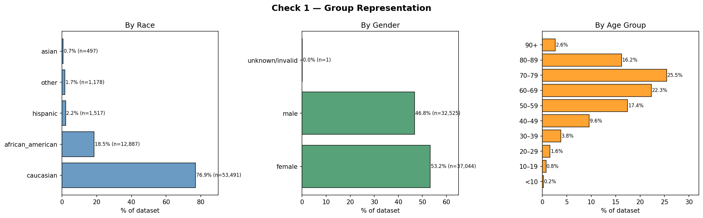
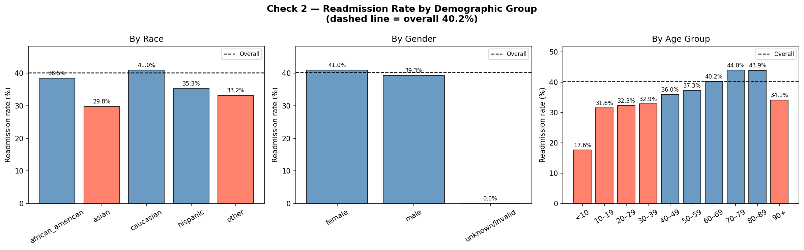
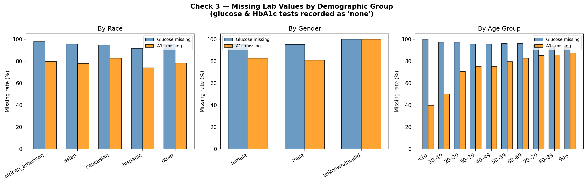

# Bias Audit Report
**Dataset:** `diabetic/data/diabetic_readmission.csv`  
**Records:** 69,570 &nbsp;|&nbsp; **Columns:** 16  
**Overall readmission rate:** 40.2%  
**Audit date:** 2026-10-14

---

## 1. Representation

**Race** — The dataset is heavily skewed toward Caucasian patients (76.9%, n=53,491). Hispanic and Asian patients together make up fewer than 3% of records (n=1,517 and n=497 respectively). Groups this small produce unreliable statistics.

**Gender** — Reasonably balanced: female 53.2% (n=37,044), male 46.8% (n=32,525). One record carries the label `unknown/invalid` — effectively a missing value.

**Age** — Most patients are in the 60–89 range. Patients under 20 are rare (< 1% combined), which limits statistical confidence for those groups.

**⚠ Flags:**
- Asian (n=497) and Hispanic (n=1,517) groups are small. Conclusions about them carry wide uncertainty.
- `unknown/invalid` gender (n=1) should be excluded from gender-based analysis.
- Age groups <10 (n=153) and 10–19 (n=526) are very small.

---

## 2. Outcome Disparities

Groups flagged as differing from the overall rate (40.2%) by more than 5 percentage points:

| Dimension | Group | Rate | Difference |
|-----------|-------|------|------------|
| Race | Asian | 29.8% | ▼ −10.4 pp |
| Race | Other | 33.2% | ▼ −7.0 pp |
| Age | <10 | 17.6% | ▼ −22.5 pp |
| Age | 10–19 | 31.6% | ▼ −8.6 pp |
| Age | 20–29 | 32.3% | ▼ −7.9 pp |
| Age | 30–39 | 32.9% | ▼ −7.3 pp |
| Age | 90+ | 34.1% | ▼ −6.1 pp |

African American patients (42.4%) are slightly above the overall rate (+2.2 pp), which does not cross the 5 pp threshold but is worth monitoring.

**Key pattern:** Readmission risk rises steadily with age, peaking at 44.0% for the 70–79 group, then drops for patients 90+ — likely reflecting survival selection or care-setting differences.

---

## 3. Missing Lab Data

Both `max_glu_serum` and `a1c_result` use `"none"` to indicate the test was not performed. Missingness is high across the board:

| Group | Glucose missing | A1c missing |
|-------|----------------|-------------|
| Caucasian | 94.6% | 82.7% |
| African American | 97.6% | 79.8% |
| Hispanic | 91.6% | 74.0% |
| Asian | 95.6% | 78.1% |
| Other | 95.4% | 78.3% |

**⚠ Flags:**
- African American patients have the highest glucose-missing rate (97.6% vs. 91.6% for Hispanic — a 6 pp gap). This could reflect differential access to glucose monitoring or documentation practices, and may introduce bias if glucose data is used as a predictive feature.
- A1c missingness is slightly lower for Hispanic (74.0%) and African American (79.8%) patients than for Caucasian (82.7%), suggesting testing patterns differ by group.
- Missing lab values are a structural issue: any model that uses these features will implicitly learn group-level missingness patterns.

---

## Summary of Findings

| Check | Status | Notes |
|-------|--------|-------|
| Representation | ⚠ Concern | Asian and Hispanic groups are small; results unreliable |
| Outcome disparities (race) | ⚠ Concern | Asian patients flagged (−10.4 pp) |
| Outcome disparities (gender) | ✅ Acceptable | Male vs. female differ by < 2 pp |
| Outcome disparities (age) | ⚠ Concern | Younger and oldest groups flagged |
| Missing data (glucose) | ⚠ Concern | 6 pp gap between African American and Hispanic groups |
| Missing data (A1c) | ⚠ Concern | Varies 8 pp across racial groups |

---

## Limitations

1. **Causality unknown.** Lower readmission rates for some groups may reflect better health outcomes *or* barriers to care (e.g., patients who cannot afford readmission). The data does not distinguish these.
2. **Small groups.** Flags for Asian, Hispanic, and young age groups are based on few records and may not generalise.
3. **Encoded missingness.** Lab values use `"none"` rather than `NaN`, which means missingness is invisible to standard tools unless explicitly handled.
4. **No socioeconomic data.** The dataset lacks income, insurance type, and geography, which are known confounders for both readmission and lab-test availability.
5. **Time of data collection unknown.** Secular trends (changes in clinical practice) could introduce temporal bias if records span many years.
